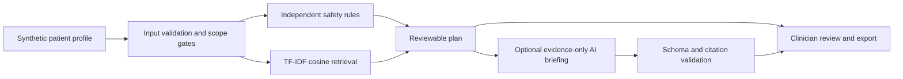

# CareWeave — AI-Driven Personalized Treatment Planner

**Personalized thinking. Evidence-grounded decisions.**

CareWeave connects diagnosis, history, renal function, verified pharmacogenetics, lifestyle and preferences into a treatment discussion that a clinician can inspect. The initial pathway focuses on **non-pregnant adults with confirmed type 2 diabetes**. It is a research prototype for **synthetic cases only**, not a prescribing system.

## Run in 30 seconds

The lightweight web track requires Node.js 20 or newer, with no packages or database. For the **HiDevs semantic RAG / Streamlit track**, follow the next section.

```sh
npm start
```

Open **http://localhost:3000**. In GitHub Codespaces, open forwarded port 3000. Choose Maya, Alex or Sam to explore different profiles. The app works without an API key, visibly labelled **rules-only**.

```sh
npm test
npm run build
```

The build emits a single dependency-free Cloudflare Worker at `dist/server/index.js`, with the web assets embedded. The local server and hosted Worker use the same planner and API handlers.

## HiDevs seven-step semantic RAG track

This track adds **local MiniLM sentence embeddings, persistent Chroma retrieval, a visible FAISS compatibility fallback, Groq/Llama synthesis, Streamlit and optional MongoDB synthetic history**. It calls the same Node safety core; clinical rules are not duplicated in Python.

Use Python 3.12 and Node.js 20+. On Windows with `uv`:

```powershell
uv venv --python 3.12 .venv
uv pip install --python .venv/Scripts/python.exe -r requirements.txt
.venv/Scripts/python.exe -m streamlit run streamlit_app.py
```

On Linux/Codespaces:

```sh
python3.12 -m venv .venv
.venv/bin/pip install -r requirements.txt
.venv/bin/python -m streamlit run streamlit_app.py
```

Open port **8501**. First semantic plan downloads the public `sentence-transformers/all-MiniLM-L6-v2` model. It needs network access and enough local memory for PyTorch. Public evidence embeddings persist in ignored `.careweave/vectors/`; patient query embeddings are not saved. Chroma is attempted first. If it is incompatible, install `requirements-faiss.txt`; fallback is visible in the report. No neural retrieval is claimed when initialization fails.

Set `GROQ_API_KEY` in an untracked `.env`, and optionally `GROQ_MODEL` (default `llama-3.3-70b-versatile`). Choose the sidebar opt-in to send **synthetic** context to Groq. Model access, billing and limits depend on your account; this project does not guarantee a free tier or model entitlement. Missing credentials leave semantic retrieval available with no model generation.

The Python track is **not running in the hosted Cloudflare Site**, whose memory/runtime cannot support this local Python stack. Deploy `streamlit_app.py` on a Python host; include Node.js for the shared safety core, `requirements.txt`, server-side environment variables and adequate resources. `packages.txt` supplies the Node OS package for Streamlit Community Cloud. Deployment to that service has not been performed.

See [the seven-step implementation guide](docs/SEVEN_STEPS.md) for ingestion, chunking, indexing, evaluation and hosting commands.

## What makes the demo useful

| Evaluation criterion | Demonstrated behavior |
| --- | --- |
| Personalization | Kidney function changes the medicine pathway; existing medicines, verified SLCO1B1 phenotype, frailty, routine, goals and affordability shape warnings and discussion. |
| Reasoning trace | Concise decision audit exposes scope checks, patient factors, retrieval method and remaining information. It does not display hidden model reasoning. |
| Evidence citation | Each clinical option and monitoring item links to an explicit evidence ID and source. The library includes NICE NG28, KDIGO 2024 and CPIC 2022 summaries. |
| Risk and monitoring | Selected renal, gene–drug, hypoglycaemia and volume-risk signals; urgent/out-of-scope withholding; monitoring tied to source IDs. |
| Vector search | Actual sparse TF-IDF vectors ranked by cosine similarity. Rule-required sources are retained outside the top retrieval results. This is not neural embedding search. |
| Prompt engineering | Server-side, evidence-only instructions; patient context treated as untrusted; strict JSON schema and citation-ID validation; independent safety rules. |

## Optional live GenAI in the lightweight web track

Copy `.env.example` to `.env`. Configure `GROQ_API_KEY` and optionally `GROQ_MODEL` for Groq/Llama, or `OPENAI_API_KEY` and `OPENAI_MODEL` for the existing OpenAI integration. Groq is selected when its key is present. Restart the server. Secrets stay server-side and are never included in browser JavaScript. The hosted version uses equivalent runtime environment variables, configured separately from the local file.

Select **Add AI evidence briefing** to explicitly send the synthetic profile, reviewed plan and retrieved evidence to the configured provider. A separate briefing summarises evidence and uncertainty; it cannot change deterministic options, risk flags or safety gates. OpenAI requests use `store: false`; neither provider integration claims zero retention or healthcare compliance. Provider usage may incur charges. No real patient information should be entered. Groq JSON mode is locally schema-checked, rather than advertised as constrained decoding.

Missing configuration, provider failure, invalid output or unknown citation IDs preserve rules-only mode with a visible explanation. Live inference has **not** been tested with a real provider credential in this build. Provider behavior is exercised through mocked contract tests.

Official integration reference: [OpenAI text generation](https://developers.openai.com/api/docs/guides/text).

## Architecture



`src/planner.mjs` owns validation, sparse vector retrieval and deterministic planning. `src/evidence.mjs` is the bounded evidence corpus. `src/service.mjs` owns the optional Responses API call. `src/worker.mjs` exposes the API and static assets. `public/` provides the responsive interface. `tests/` contains safety, retrieval, API and provider-contract checks.

The lightweight web app uses no patient persistence, cookies, analytics, external fonts or client API keys. The Streamlit track optionally saves synthetic reports only after explicit opt-in and MongoDB configuration, with a seven-day expiry index. This is session-scoped report history, not a conversational chatbot. No production authentication or medical data storage is claimed. Input changes invalidate the previous report. Export includes source IDs, patient context, risks, missing information, timestamps and limitations. Web-track printing includes the complete report across all tabs.

## Verification

25 JavaScript checks cover renal boundaries, unsupported/urgent profiles, selected medication risks, input bounds, citation integrity, sparse retrieval, provider contracts and API handling. 14 Python checks cover preprocessing, provenance, document/query windowing, semantic report assembly, provider validation, history consent and the Streamlit urgent-case/edit-invalidation flow. A passing software test is not evidence of clinical validity.

Browser QA confirmed case switching, safety/evidence tabs, stale-plan invalidation, urgent-plan withholding and a narrow layout. See `docs/VERIFICATION.md` for the verification record and limitations.

## Safety and evidence boundaries

This prototype is not clinically validated, cleared as a medical device or ready for clinical deployment. It offers class-level discussion, no prescriptions or dose calculations. Interaction screening, allergy matching, acute-symptom detection and clinical history are incomplete. A selected rule not firing does not mean a treatment is safe. Genetic phenotypes must come from a verified report; unknown genetics remain unknown.

The corpus uses UK NICE pathways and international KDIGO/CPIC references. Local prescribing labels, resources and practices may differ. Summaries are original, brief paraphrases, not full guideline reproductions. Corpus assembled on 14 November 2026; it does not continuously update or search live literature. NICE page retrieval was restricted during build; indexed official guidance was used to check pathway summaries. Verify original sections and medicine labels at point of care.

The current hosted Site is owner-private and is not a public judge-accessible demo. Submission status must be verified on the actual HiDevs challenge page; a code push is not a challenge submission.

## Google Cloud Run preparation and Windows launch

The full Streamlit container is prepared and verified on a Linux GitHub runner. See [Cloud Run deployment and status](docs/CLOUD_RUN.md). A separate CareWeave cloud project exists, but the user approved Cloud Shell access only and declined billable deployment; no Cloud Run service was deployed.

On Windows, `Start-CareWeave.ps1` selects the project directory and its own virtual environment, and reuses the existing local server when it is already running. Run it from the project folder, or invoke it using its full path. The installed workspace's Python runtime was copied into ignored `.runtime/python312` and the local virtual environment rebased there, removing dependence on the managed `AppData/Roaming/uv` path that was missing in the user's terminal. Runtime binaries are not committed; new clones still need the installation steps above.
