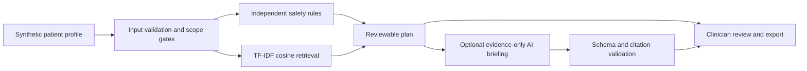

# CareWeave — AI-Driven Personalized Treatment Planner

**Personalized thinking. Evidence-grounded decisions.**

CareWeave connects diagnosis, history, renal function, verified pharmacogenetics, lifestyle and preferences into a treatment discussion that a clinician can inspect. The initial pathway focuses on **non-pregnant adults with confirmed type 2 diabetes**. It is a research prototype for **synthetic cases only**, not a prescribing system.

## Run in 30 seconds

Requires Node.js 20 or newer. No packages, Python environment or database are required.

```sh
npm start
```

Open **http://localhost:3000**. In GitHub Codespaces, open forwarded port 3000. Choose Maya, Alex or Sam to explore different profiles. The app works without an API key, visibly labelled **rules-only**.

```sh
npm test
npm run build
```

The build emits a single dependency-free Cloudflare Worker at `dist/server/index.js`, with the web assets embedded. The local server and hosted Worker use the same planner and API handlers.

## What makes the demo useful

| Evaluation criterion | Demonstrated behavior |
| --- | --- |
| Personalization | Kidney function changes the medicine pathway; existing medicines, verified SLCO1B1 phenotype, frailty, routine, goals and affordability shape warnings and discussion. |
| Reasoning trace | Concise decision audit exposes scope checks, patient factors, retrieval method and remaining information. It does not display hidden model reasoning. |
| Evidence citation | Each clinical option and monitoring item links to an explicit evidence ID and source. The library includes NICE NG28, KDIGO 2024 and CPIC 2022 summaries. |
| Risk and monitoring | Selected renal, gene–drug, hypoglycaemia and volume-risk signals; urgent/out-of-scope withholding; monitoring tied to source IDs. |
| Vector search | Actual sparse TF-IDF vectors ranked by cosine similarity. Rule-required sources are retained outside the top retrieval results. This is not neural embedding search. |
| Prompt engineering | Server-side, evidence-only instructions; patient context treated as untrusted; strict JSON schema and citation-ID validation; independent safety rules. |

## Optional live GenAI

Copy `.env.example` to `.env` and configure `OPENAI_API_KEY` and `OPENAI_MODEL` with a model available to your account. Restart the server. Secrets stay server-side and are never included in browser JavaScript. The hosted version uses equivalent runtime environment variables, configured separately from the local file.

Select **Add AI evidence briefing** to explicitly send the synthetic profile, reviewed plan and retrieved evidence to the OpenAI Responses API. A separate briefing summarises the evidence and uncertainty; it cannot change deterministic options, risk flags or safety gates. The request uses `store: false`; this is not a claim of zero retention or healthcare compliance. Provider usage may incur charges. No real patient information should be entered.

Missing configuration, provider failure, invalid output or unknown citation IDs preserve rules-only mode with a visible explanation. Live inference has **not** been tested with a real provider credential in this build. Provider behavior is exercised through mocked contract tests.

Official integration reference: [OpenAI text generation](https://developers.openai.com/api/docs/guides/text).

## Architecture



`src/planner.mjs` owns validation, sparse vector retrieval and deterministic planning. `src/evidence.mjs` is the bounded evidence corpus. `src/service.mjs` owns the optional Responses API call. `src/worker.mjs` exposes the API and static assets. `public/` provides the responsive interface. `tests/` contains safety, retrieval, API and provider-contract checks.

The app uses no patient persistence, cookies, analytics, external fonts or client API keys. Input changes invalidate the previous report. Export includes source IDs, patient context, risks, missing information, timestamps and limitations. Printing includes the complete report across all tabs.

## Verification

22 automated checks cover renal boundary values (19/20 and 29/30), urgent and unsupported profiles, missing allergies/medicines, genetics, selected high-risk medicines, input bounds, citation integrity, query-sensitive retrieval, API origin/type/size checks, provider failure and AI response validation. A passing software test is not evidence of clinical validity.

Browser QA confirmed case switching, safety/evidence tabs, stale-plan invalidation, urgent-plan withholding and a narrow layout. See `docs/VERIFICATION.md` for the verification record and limitations.

## Safety and evidence boundaries

This prototype is not clinically validated, cleared as a medical device or ready for clinical deployment. It offers class-level discussion, no prescriptions or dose calculations. Interaction screening, allergy matching, acute-symptom detection and clinical history are incomplete. A selected rule not firing does not mean a treatment is safe. Genetic phenotypes must come from a verified report; unknown genetics remain unknown.

The corpus uses UK NICE pathways and international KDIGO/CPIC references. Local prescribing labels, resources and practices may differ. Summaries are original, brief paraphrases, not full guideline reproductions. Corpus assembled on 14 November 2026; it does not continuously update or search live literature. NICE page retrieval was restricted during build; indexed official guidance was used to check pathway summaries. Verify original sections and medicine labels at point of care.

The current hosted Site is owner-private and is not a public judge-accessible demo. Submission status must be verified on the actual HiDevs challenge page; a code push is not a challenge submission.
